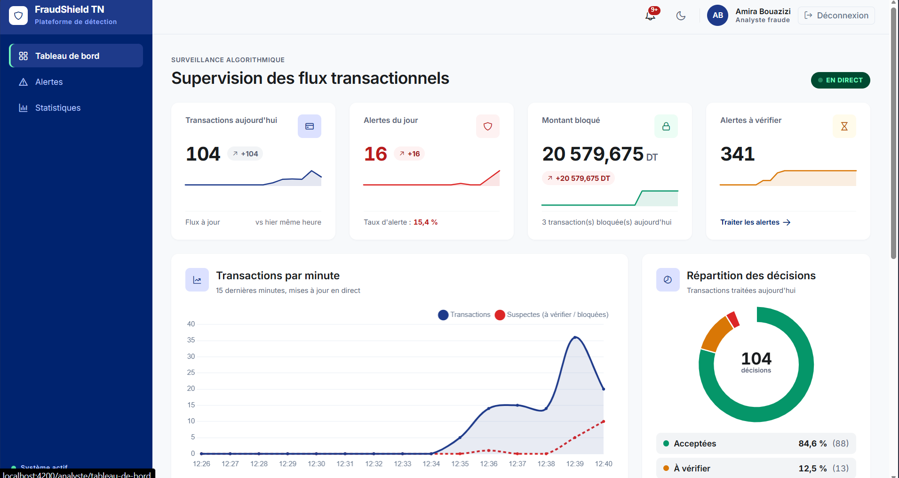
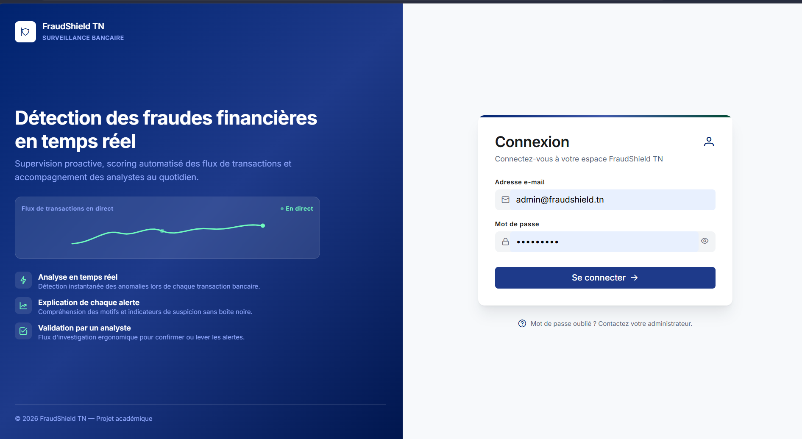
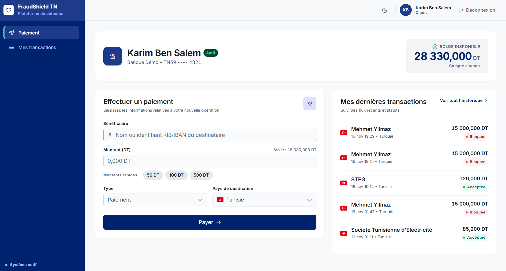
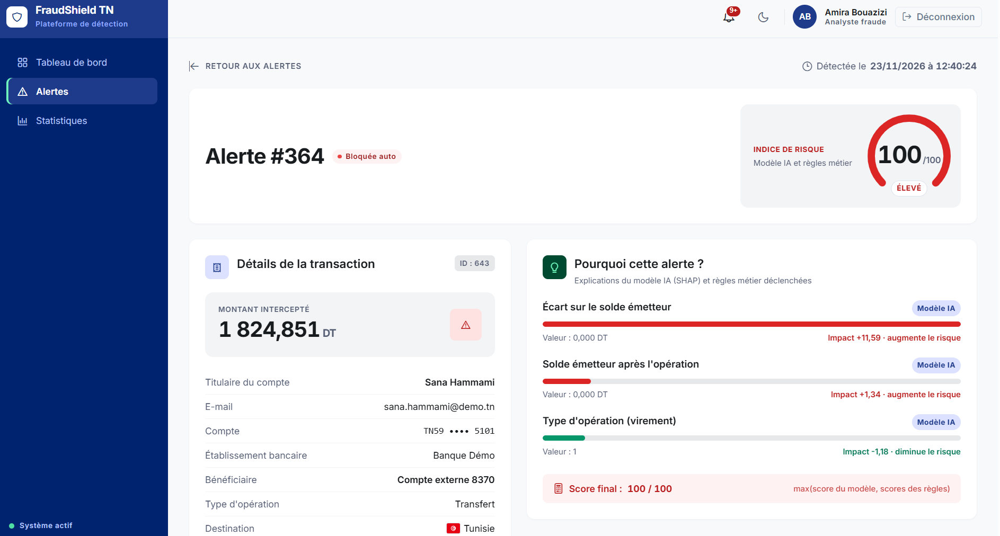
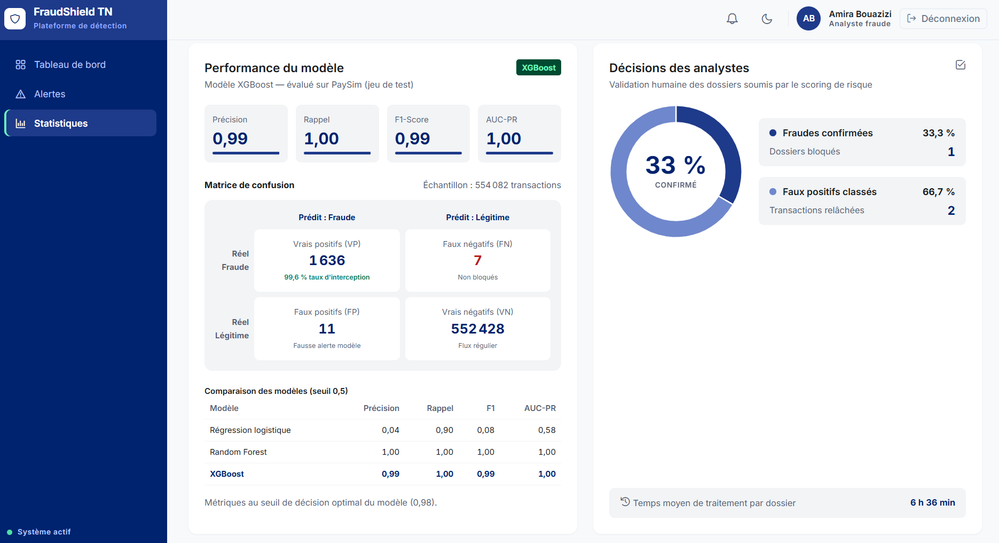
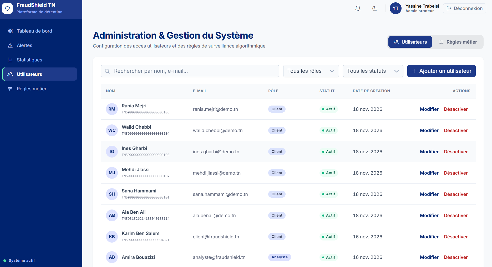
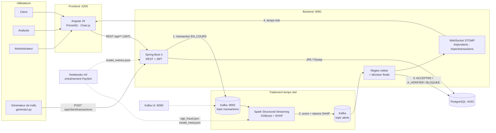
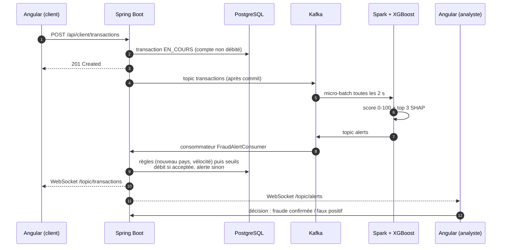

# FraudShield TN

**FraudShield TN** est une plateforme de détection de fraude bancaire **en temps réel**, conçue pour
une banque tunisienne fictive. Chaque paiement saisi par un client suit ce parcours :

1. Il est publié dans **Kafka**.
2. Il est scoré par un modèle **XGBoost** dans un job **Spark Structured Streaming**, avec des
   explications **SHAP**.
3. Ce score est combiné à des **règles métier** modifiables par l'administrateur.
4. La décision est poussée par **WebSocket** au client et au tableau de bord des analystes.

| Rôle          | Ce qu'il fait |
|---------------|---------------|
| Client        | Effectue des paiements et suit leur statut en direct (en cours, acceptée, à vérifier, bloquée) |
| Analyste      | Surveille le flux en temps réel, examine les alertes et leurs explications, confirme la fraude ou classe en faux positif, consulte les statistiques |
| Administrateur | Gère les utilisateurs et ajuste les seuils des règles métier, appliqués dès la transaction suivante |



<table>
  <tr>
    <td></td>
    <td></td>
    <td></td>
  </tr>
  <tr>
    <td></td>
    <td></td>
  </tr>
</table>

> Les captures sont à déposer dans [`docs/screenshots/`](docs/screenshots/README.md).

---

## Sommaire

1. [Architecture](#architecture)
2. [Technologies et choix](#technologies-et-choix)
3. [Résultats du modèle](#résultats-du-modèle)
4. [Installation et lancement](#installation-et-lancement)
5. [Comptes de démonstration](#comptes-de-démonstration)
6. [Scénario de démonstration](#scénario-de-démonstration)
7. [Limites et améliorations possibles](#limites-et-améliorations-possibles)
8. [Structure du dépôt](#structure-du-dépôt)

---

## Architecture



### Parcours d'un paiement



**Décision hybride.** Le score final est `max(score du modèle, scores des règles déclenchées)` :
- `MAX_AMOUNT_NEW_COUNTRY` donne 85 : montant supérieur au seuil (10 000 DT) vers un pays jamais
  accepté pour ce compte ;
- `VELOCITY_10_MIN` donne 60 : plus de 5 transactions sur 10 minutes.

Les seuils de décision sont les suivants :

| Score final | Décision |
|-------------|----------|
| ≥ `AUTO_BLOCK_SCORE` (80 par défaut) | **BLOQUEE** |
| ≥ 50 | **A_VERIFIER**, une alerte est créée pour les analystes |
| en dessous | **ACCEPTEE**, le compte est débité |

Les règles sont relues en base à chaque transaction : une modification faite dans l'administration
s'applique immédiatement.

---

## Technologies et choix

| Couche | Technologie | Pourquoi ce choix |
|--------|-------------|-------------------|
| Frontend | **Angular 20** (standalone, signals, zoneless), **PrimeNG 20**, **Chart.js** | Framework structuré et typé, adapté à une application métier à plusieurs rôles. Les signals et le mode zoneless rendent efficacement un flux temps réel. PrimeNG fournit tableaux paginés, dialogues et formulaires accessibles. |
| Temps réel | **WebSocket STOMP** (`@stomp/stompjs`, broker simple Spring) | Mise à jour poussée du statut des paiements et du tableau de bord, sans interrogation périodique. STOMP apporte des sujets (`/topic/...`) prêts à l'emploi. |
| Backend | **Spring Boot 4.1** (Java 17), Spring Security, Spring Data JPA | Écosystème standard dans le secteur bancaire, qui fournit sécurité, validation, transactions et consommateurs Kafka. |
| Authentification | **JWT** (jjwt, HMAC-SHA256), mots de passe **BCrypt** | API sans état, rôles CLIENT, ANALYSTE et ADMIN portés par le token. La clé est surchargée par `JWT_SECRET`. |
| Base de données | **PostgreSQL 16** + **Flyway** | Base relationnelle fiable pour des montants (`NUMERIC(15,3)`, millimes). Flyway versionne le schéma et Hibernate le valide (`ddl-auto: validate`). |
| Messagerie | **Apache Kafka 3.9** (mode KRaft, sans ZooKeeper) | Découple la saisie du paiement de son scoring, absorbe les pics et permet de rejouer les messages. **Kafka UI** sert à inspecter les topics. |
| Scoring en flux | **Spark Structured Streaming 3.5** (PySpark) | Traitement en micro-batches toutes les 2 s avec point de reprise (checkpoint). Le même job pourrait passer en cluster sans réécriture. |
| Modèle | **XGBoost 3.4** | Très performant sur des données tabulaires déséquilibrées, rapide en inférence et léger à déployer (un fichier JSON). |
| Explicabilité | **SHAP** (`TreeExplainer`) | Les 3 variables les plus influentes sont affichées à l'analyste avec leur impact : une décision de blocage doit pouvoir se justifier. |
| Données | **PaySim** (Kaggle) | Jeu public de transactions mobiles simulées avec étiquette de fraude. Les vraies données bancaires sont confidentielles. |
| Simulation | **Python + requests** (`generator/`) | Produit un flux continu et réaliste pour la démonstration et les tests de charge légers. |
| Conteneurs | **Docker Compose** | Lance Kafka, Kafka UI, PostgreSQL et le job Spark en une commande, avec les mêmes versions pour tous. |

---

## Résultats du modèle

Ces valeurs proviennent de [`ml/models/model_metrics.json`](ml/models/model_metrics.json), écrit par la
dernière cellule de [`ml/02_entrainement.ipynb`](ml/02_entrainement.ipynb).

- **Données :** PaySim, opérations `TRANSFER` et `CASH_OUT` uniquement, les seules où la fraude existe.
- **Jeu de test :** 554 082 transactions.
- **Date d'évaluation :** 17/11/2026.

**XGBoost, au seuil optimal F1 de 0,984 :**

| Précision | Rappel | F1 | AUC-PR |
|----------:|-------:|---:|-------:|
| **99,33 %** | **99,57 %** | **99,45 %** | **0,9974** |

**Matrice de confusion :**

|                 | Prédit fraude | Prédit légitime |
|-----------------|--------------:|----------------:|
| **Fraude réelle**   | 1 636 (VP) | 7 (FN) |
| **Légitime réelle** | 11 (FP) | 552 428 (VN) |

Sur 1 643 fraudes, 7 passent sans être détectées. 11 transactions légitimes sur plus de 552 000 sont
signalées à tort.

**Comparaison des modèles, au seuil de 0,5 :**

| Modèle | Précision | Rappel | F1 | AUC-PR |
|--------|----------:|-------:|---:|-------:|
| Régression logistique | 0,0435 | 0,8996 | 0,0831 | 0,5751 |
| Random Forest | 1,0000 | 0,9970 | 0,9985 | 0,9980 |
| **XGBoost** (retenu) | 0,9909 | 0,9963 | 0,9936 | 0,9974 |

La forêt aléatoire obtient des scores équivalents, très légèrement supérieurs. XGBoost a été retenu
pour trois raisons :
- un modèle bien plus compact ;
- une inférence plus rapide dans le micro-batch Spark ;
- des explications SHAP `TreeExplainer` rapides à calculer pour chaque transaction.

La page **Statistiques** affiche ces métriques. Elle relit le fichier à chaque appel : un nouvel
entraînement y apparaît sans redémarrer le backend.

**Variables du modèle :**
- type d'opération ;
- montant ;
- soldes de l'émetteur et du bénéficiaire avant et après l'opération ;
- écarts entre soldes attendus et réels ;
- heure.

Le schéma de fraude PaySim typique est le **transfert de la totalité du solde**. Le modèle le
reconnaît avec un score proche de 100.

---

## Installation et lancement

### Prérequis

| Outil | Version testée | Utilisation |
|-------|----------------|-------------|
| Docker Desktop (Compose v2) | — | Kafka, Kafka UI, PostgreSQL, job Spark |
| JDK | 17 ou plus | Backend (le wrapper Maven `mvnw` est fourni) |
| Node.js + npm | 20.19+, 22.12+ ou 24 | Frontend Angular |
| Python | 3.12 ou plus | Notebooks (facultatif) et générateur de trafic |

**Ports utilisés :**

| Service | Port | URL |
|---------|------|-----|
| Frontend Angular | 4200 | http://localhost:4200 |
| Backend Spring Boot | 8081 | http://localhost:8081 |
| PostgreSQL | 5433 (vers 5432 dans le conteneur) | `jdbc:postgresql://localhost:5433/fraudshield` |
| Kafka | 9092 | `localhost:9092` |
| Kafka UI | 8090 | http://localhost:8090 |

Les commandes ci-dessous sont écrites pour PowerShell sous Windows. Sous Linux ou macOS, remplacer
`.\mvnw.cmd` par `./mvnw` et `ml\.venv\Scripts\python.exe` par `ml/.venv/bin/python`.

### 1. Infrastructure : Kafka, Kafka UI, PostgreSQL, Spark

```powershell
docker compose up -d --build
docker compose ps        # kafka, kafka-ui, postgres et spark-job : "running"
```

Le premier build de l'image `spark-job` prend plusieurs minutes. Il installe Python 3.12, XGBoost
et SHAP, puis télécharge le connecteur Kafka. Le job lit le modèle dans `ml/models/`, monté en
lecture seule. Pour suivre son démarrage :

```powershell
docker compose logs -f spark-job     # attendre "Job démarré : transactions -> alerts"
```

### 2. Backend Spring Boot

```powershell
cd backend
.\mvnw.cmd spring-boot:run
```

Au premier démarrage :
- Flyway crée le schéma (`V1__init.sql`) ;
- `DataInitializer` crée les comptes de démonstration et les 3 règles métier ;
- `DemoClientsInitializer` ajoute les 5 clients utilisés par le générateur.

| Variable d'environnement | Valeur par défaut (développement) |
|--------------------------|-----------------------------------|
| `JWT_SECRET` | clé de développement : **à définir en production** (32 caractères minimum) |
| `DB_URL`, `DB_USERNAME`, `DB_PASSWORD` | base `fraudshield` du `docker-compose.yml` |
| `MODEL_METRICS_PATH` | `file:../ml/models/model_metrics.json` |

### 3. Frontend Angular

```powershell
cd frontend
npm ci
npx ng serve             # http://localhost:4200
```

### 4. Générateur de trafic (facultatif)

```powershell
python -m venv ml\.venv                       # si l'environnement n'existe pas encore
ml\.venv\Scripts\pip install -r ml\requirements.txt
ml\.venv\Scripts\python.exe generator\generator.py --fraud-ratio 0.3
```

Les options et les scénarios sont détaillés dans [`generator/README.md`](generator/README.md).

### 5. Réentraîner le modèle (facultatif)

Le modèle entraîné est déjà fourni dans `ml/models/`. Pour le régénérer :

1. Télécharger le jeu PaySim depuis Kaggle (*Synthetic Financial Datasets For Fraud Detection*).
2. L'enregistrer sous `ml/data/paysim.csv`.
3. Lancer :

```powershell
cd ml
.venv\Scripts\jupyter nbconvert --to notebook --execute --inplace 02_entrainement.ipynb
docker compose restart spark-job     # recharge xgb_fraud.json
```

Le notebook régénère `xgb_fraud.json`, `model_meta.json` et `model_metrics.json`. Pour tester le
scoring hors ligne, sans Spark ni Kafka :
`ml\.venv\Scripts\python.exe spark-job\test_model.py`.

---

## Comptes de démonstration

| Rôle | E-mail | Mot de passe | Remarque |
|------|--------|--------------|----------|
| Administrateur | `admin@fraudshield.tn` | `Admin123!` | Yassine Trabelsi |
| Analyste | `analyste@fraudshield.tn` | `Analyste123!` | Amira Bouazizi |
| Client | `client@fraudshield.tn` | `Client123!` | Karim Ben Salem : 28 450 DT |
| Clients du générateur | `sana.hammami@demo.tn`, `mehdi.jlassi@demo.tn`, `ines.gharbi@demo.tn`, `walid.chebbi@demo.tn`, `rania.mejri@demo.tn` | `Demo123!` | Soldes de 9 800 à 125 000 DT |

> Ces comptes ne servent qu'à la démonstration et ne doivent pas être conservés sur une instance réelle.

---

## Scénario de démonstration

Il faut deux fenêtres de navigateur distinctes, par exemple une fenêtre normale et une fenêtre de
navigation privée : la session JWT est stockée dans le navigateur.

1. **Paiement normal accepté.** Dans la fenêtre 1, se connecter avec `client@fraudshield.tn` et payer
   *STEG*, 85 DT, Tunisie, type *Paiement*.
   - Le statut passe en direct de **En cours** à **Acceptée** en quelques secondes.
   - Le solde est débité.

2. **Flux temps réel côté analyste.** Dans la fenêtre 2, se connecter avec `analyste@fraudshield.tn` et
   ouvrir le **Tableau de bord**. Lancer ensuite le générateur dans un terminal :
   `ml\.venv\Scripts\python.exe generator\generator.py --fraud-ratio 0.3`.
   - Les transactions et les alertes arrivent en direct.
   - Les indicateurs se mettent à jour sans recharger la page.

3. **Fraude bloquée et expliquée.** Dans la fenêtre 1 (client), faire un *Transfert* de **la totalité
   du solde**, schéma PaySim. Ou bien faire un *Transfert* de 15 000 DT vers la **Turquie**, pays nouveau pour ce
   compte : la règle `MAX_AMOUNT_NEW_COUNTRY` s'applique.
   - Le statut passe à **Bloquée** et le compte n'est pas débité.
   - Côté analyste, ouvrir l'alerte. Le détail montre le score, les règles déclenchées et les
     3 raisons SHAP du modèle.

4. **Décision de l'analyste.** Sur une alerte **À vérifier**, issue d'une rafale du générateur,
   choisir *Faux positif* avec un commentaire.
   - La transaction est acceptée et le compte débité.
   - Ouvrir ensuite **Statistiques**, sur 7 ou 30 jours : courbe des fraudes, répartition par type,
     top des pays, métriques XGBoost et matrice de confusion, répartition des décisions des
     analystes.

5. **Règle métier modifiée à chaud.** Se connecter avec `admin@fraudshield.tn`, ouvrir
   **Administration → Règles métier** et passer `AUTO_BLOCK_SCORE` de 80 à **90**.
   - Un nouveau virement de 15 000 DT vers un pays encore jamais utilisé, la **Libye** par exemple,
     obtient le score 85 de la règle « nouveau pays ».
   - Ce score est maintenant sous le seuil de 90 : la transaction passe **À vérifier** au lieu de
     *Bloquée*, sans redémarrage.
   - Dans **Utilisateurs**, créer un client : son compte est ouvert avec 10 000 DT.

---

## Limites et améliorations possibles

- **Données simulées.**
  - Le modèle est entraîné sur PaySim, des transactions de mobile money *synthétiques*, et non sur
    de vraies opérations tunisiennes.
  - Les scores quasi parfaits viennent en partie des variables d'écart de solde, très révélatrices
    dans ce simulateur. Sur des données réelles, il faudrait s'attendre à des performances plus
    faibles et à un recalibrage des seuils.
  - Les paiements de type `PAYMENT` sont hors du domaine d'entraînement : le modèle leur donne
    systématiquement 0, et seules les règles métier peuvent les signaler.
- **Checkpoint Spark dans `/tmp`.**
  - Le point de reprise du job est stocké dans `/tmp/checkpoints` *à l'intérieur du conteneur*, et
    il est perdu si le conteneur est recréé.
  - Avec `startingOffsets=latest`, les transactions publiées pendant l'arrêt du job ne sont alors
    jamais scorées.
  - Amélioration : un volume Docker dédié au checkpoint, ou un stockage objet (S3, HDFS).
- **Idempotence.**
  - Le backend ignore une alerte rejouée pour une transaction déjà traitée.
  - En revanche, `POST /api/client/transactions` n'a pas de clé d'idempotence : un client qui
    renvoie sa requête après un délai réseau crée un second paiement.
  - L'écriture Spark vers Kafka est « au moins une fois », et un micro-batch rejoué publie des
    doublons.
  - Améliorations : en-tête `Idempotency-Key` côté API, producteur Kafka idempotent ou
    transactionnel.
- **Transactions restées `EN_COURS`.**
  - Si Spark ou Kafka est indisponible, ou si le message est perdu (voir le checkpoint), la
    transaction reste `EN_COURS` indéfiniment et le client n'a jamais de réponse.
  - Amélioration : une tâche planifiée qui republie ou passe en « À vérifier » les transactions
    sans décision après N minutes, et une alerte de supervision.
- **Réentraînement à partir des décisions des analystes.**
  - Les décisions *Fraude confirmée* et *Faux positif* sont enregistrées en base, mais ne servent
    pas encore à améliorer le modèle.
  - Amélioration : un export périodique de ces étiquettes, un réentraînement, une comparaison
    avec le modèle en production, puis un déploiement versionné. La version du modèle
    (`modelVersion`) est déjà transmise avec chaque score.
- **Autres pistes.**
  - Sécuriser la connexion WebSocket par JWT (aujourd'hui seule l'origine est contrôlée).
  - Ajouter un journal d'audit des modifications de règles.
  - Remplacer le broker STOMP en mémoire par un relais (RabbitMQ) pour plusieurs instances du
    backend.
  - Ajouter des tests d'intégration (Testcontainers) et de la supervision (Prometheus/Grafana).

---

## Structure du dépôt

```
fraudshield-tn/
├── backend/            API Spring Boot (REST, JWT, Kafka, règles métier, WebSocket)
├── frontend/           Application Angular (espaces client, analyste, administrateur)
├── spark-job/          Job Spark Structured Streaming : scoring XGBoost + SHAP
├── ml/                 Notebooks d'exploration et d'entraînement, modèle livré (ml/models/)
├── generator/          Générateur de trafic de démonstration
├── maquettes/          Maquettes Stitch des écrans
├── docs/screenshots/   Captures d'écran du README
└── docker-compose.yml  Kafka, Kafka UI, PostgreSQL, job Spark
```
